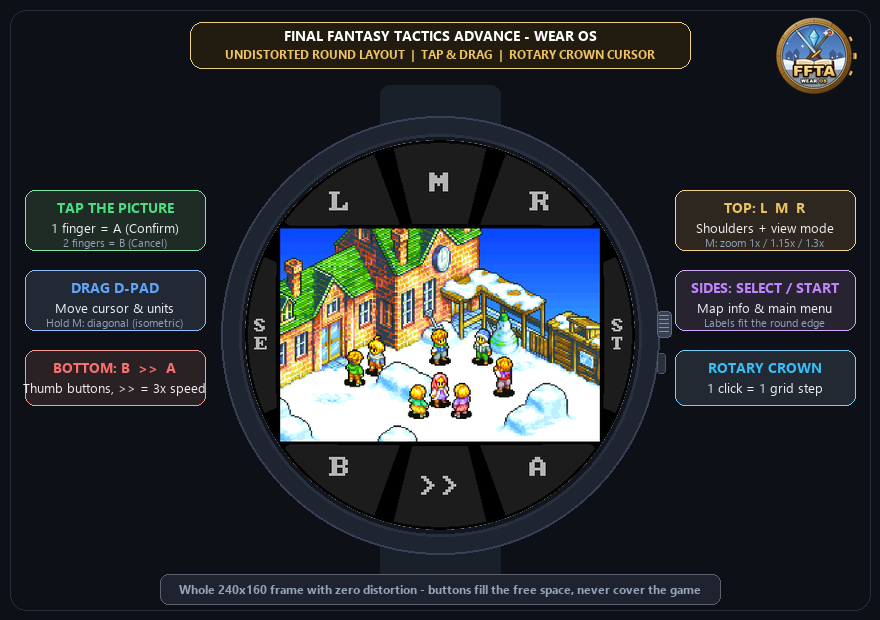

# Final Fantasy Tactics Advance (FFTA) - Wear OS & Android Port

A native port of **Final Fantasy Tactics Advance** (GBA, 2003) built for **Wear OS smartwatches** with round displays (Samsung Galaxy Watch 4/5/6/7/Ultra, Google Pixel Watch 1/2/3, Xiaomi Watch 2, etc.), plus Android phones and desktop. It embeds the **libmgba** core (MPL-2.0) in a custom **SDL3** shell. The ROM is **not** distributed: each player sends their own copy (USA `AFXE`, EUR `AFXP` and JPN `AFXJ` are accepted).

> **About this folder:** this Wear OS build lives inside the [FFTARecomp](https://github.com/Jorge262007/FFTARecomp) tree but is self-contained: it does not touch the recompiler, its crates or the phone `AndroidPort`. It currently runs the game through libmgba rather than the recompiled code; moving the watch shell (round layout, gestures, crown, QR transfer) onto the FFTARecomp core is the natural next step.

<p align="center">
  
</p>

---

## ⌚ What We Ported & Built for Wear OS

- **🖼️ Undistorted Round Layout**: The whole 240×160 frame is drawn as the largest 3:2 picture that fits the round glass. Nothing is cropped, bent or stretched, and every pixel is scaled evenly.
- **🔍 Three Screen Presets**: Tap **`M`** to cycle **Whole screen** (default), **Zoom** (1.15×) and **Strong zoom** (1.30×). Your choice is remembered between sessions.
- **🎮 Buttons in the Free Space**: The buttons fill the caps around the picture, and their inner edge follows the picture border, so no button ever covers a game pixel.
  - **`L` / `M` / `R`** (top cap)
  - **`B` / `>>` / `A`** (bottom cap, under the thumbs)
  - **`SELECT` / `START`** (side crescents)
- **👆 Tap & Drag Gestures**:
  | Gesture | Action |
  | :--- | :--- |
  | **Drag** anywhere | D-pad (the anchor follows your thumb; a quick flick = one tile) |
  | **Quick tap** on the picture | `A` (confirm) |
  | **Two-finger tap** | `B` (cancel) |
  | Dragging + **tap with another finger** | `A` without releasing the cursor |
  | **Hold `M`** | Diagonal drag on/off for isometric battle maps (up-right = ↑, up-left = ←, down-left = ↓, down-right = →) |
  | **`>>`** | 3× speed on/off (long battles and dialogue) |
  | Watch **back** button | `B` |
- **⌚ Rotary Crown / Bezel Cursor**: One crown click = one up/down step in menus, lists and abilities.
- **🧭 Steady D-pad**: A hysteresis band keeps the cursor from jumping between two directions while your thumb rests on a diagonal.
- **💾 Auto Resume**: Watches kill background apps often, so the game state is saved to `ffta.auto.ss` whenever the app leaves the screen and restored on the next launch. The cartridge save is kept in `ffta.sav`.
- **📲 Wi-Fi ROM Transfer (QR Code)**: Wear OS has no file picker. Instead, the watch shows a QR code: scan it with your phone and send your `.gba` over Wi-Fi. The ROM is validated by its header, imported, and the upload copy is deleted right away.
- **🔒 Portrait Lock**: The game never rotates on the watch.
- **🌙 Idle Fade**: The buttons dim after 4 s without a touch. Bluetooth gamepads (SDL3) and keyboards also work.

---

## 🚀 How to Build & Install for Wear OS

### 0. Get the sources
mGBA 0.10.5 and SDL 3.4.10 are git submodules pinned to their release tags:
```bash
git clone --recurse-submodules https://github.com/gusdslara/FFTARecomp-wearOS.git
cd FFTARecomp-wearOS/WearOS
# already cloned? run: git submodule update --init --recursive
```

### 1. Build the Wear OS APK
```bash
cd android
./gradlew :wear:assembleDebug
```
Output APK:
`android/wear/build/outputs/apk/debug/wear-debug.apk`

Use JDK 17/21 (for example, set `JAVA_HOME` to Android Studio's `jbr`). ABIs: armeabi-v7a, arm64-v8a, x86_64.

### 2. Install on your Smartwatch via ADB Wi-Fi
```bash
adb connect <WATCH_IP>:<PORT>
adb install -r android/wear/build/outputs/apk/debug/wear-debug.apk
```

### 3. ROM Setup
1. Open the app on the watch: it shows a **QR code** with the transfer address.
2. Scan it with a phone on the same Wi-Fi network and upload your `.gba`.
3. The watch validates the header (`AFX*`), imports the ROM into private storage and deletes the uploaded file.

The watch has to stay unlocked with the app on screen during the upload (Wear OS blocks the network for background apps).

**Developer shortcut:** debug builds bundle any `.gba` placed in `android/wear/dev-rom/` and import it on first launch. Build with `-PwearNoRom` to leave it out. `*.gba` files are git-ignored.

---

## 📱 Building for Android Phones / Tablets

```bash
cd android
./gradlew :app:assembleDebug
```
Output APK: `android/app/build/outputs/apk/debug/app-debug.apk`

On the phone, the app opens the system file picker to choose the ROM.

---

## 🖥️ Desktop Build (Windows/MinGW, Linux, macOS)

```bash
cmake -S . -B build/desktop -G Ninja -DCMAKE_BUILD_TYPE=Release
cmake --build build/desktop
./build/desktop/ffta "path/ffta.gba" --round --size 432x432   # simulates a round watch
./build/desktop/ffta --round --selftest                       # tests the touch gestures
./build/desktop/ffta --round --pattern                        # test card in every screen preset -> shots/
```
**Shortcuts:**

| Key | Action |
| :--- | :--- |
| F3 | Screen preset |
| F4 | Overlay |
| F5 / F7 | Save / load state |
| F6 | Filter |
| F8 | Diagonal drag |
| F9 | Debug |
| Tab (hold) | Turbo |
| P | Pause |
| F11 | Fullscreen |
| Mouse wheel | Up / down |

`--fresh` ignores the auto-resume state.

---

## 🗂️ Project Structure
```
src/main.c    SDL3 loop (callbacks), audio, turbo, auto resume, --pattern / --selftest / --test
src/emu.c     libmgba wrapper (ROM, frame, blip audio, save, savestate)
src/input.c   touch gestures, crown, gamepad, keyboard -> GBA keys
src/view.c    round layout, screen presets, cap buttons, toasts
android/      :wear and :app + common/ (LauncherActivity, GameActivity, RomStore, RomInbox QR transfer)
externals/    git submodules: mgba 0.10.5, SDL release-3.4.10
```

---

## 📜 Credits & Acknowledgments

- Original game by **Square** / **Square Enix** and **Nintendo** (2003). Final Fantasy Tactics Advance is a trademark of Square Enix. Use only your own legally owned copy.
- [FFTARecomp](https://github.com/Jorge262007/FFTARecomp) by Jorge262007, the project this fork is based on (itself built on [gba-recomp](https://github.com/JRickey/gba-recomp) by JRickey).
- Emulation core: [mGBA](https://github.com/mgba-emu/mgba) by endrift (MPL-2.0).
- Powered by [SDL3](https://github.com/libsdl-org/SDL) (zlib) and [ZXing](https://github.com/zxing/zxing) for the QR code (Apache-2.0).
- The app icon is original artwork.
